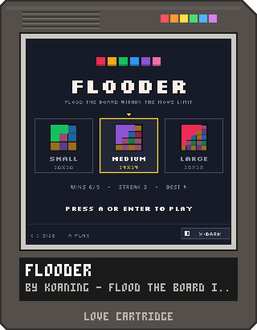
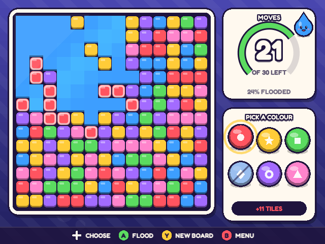
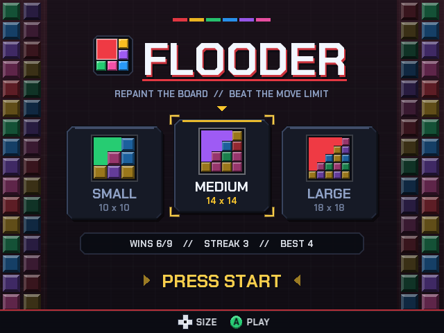
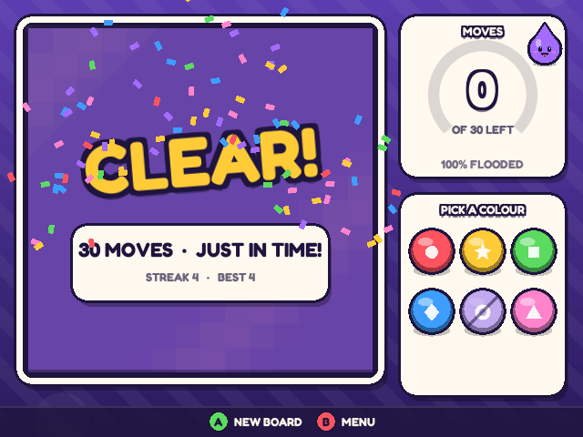

# Flooder

flood the board in as few moves as you can

A [LÖVE](https://love2d.org) (11.5) game built for handhelds (PortMaster /
[Geyser](https://github.com/koaning/geyser)) and the browser via `love.js`.

| Cartridge | Gameplay |
| --- | --- |
|  |  |
|  |  |

## Play

```sh
make run            # locally with LÖVE 11.5
make fetch-lovejs   # once: download the love.js runtime
make serve          # in the browser with COOP/COEP headers
```

You own the region in the top-left corner. Each move repaints it with a new colour, which
absorbs every touching cell of that colour. Flood the whole board before you run out of
moves. Each board's move limit is what a greedy bot (always take the biggest gain) needs to
clear it, so every board can be won but you have to play at least as well as the bot.
Pick a 10×10, 14×14 or 18×18 grid from the menu.

Controls: D-pad / arrows pick a colour in the vertical sidebar (the cells it would take are
outlined), A / Space / Enter floods. Keys 1–6 or clicking a cell / colour bar pick directly.
B / Backspace returns to the menu (where you can pick the grid size and switch between Paper
and Ink themes), Y / R deals a new board, Esc (or Back) quits.

## Credits

UI font: [Barlow](https://github.com/jpt/barlow) by Jeremy Tribby, SIL Open Font License 1.1
(`assets/fonts/OFL.txt`).

## Package

```sh
make love           # build dist/flooder.love
make screenshots    # capture docs/screenshots/{title,cart,gameplay,win,lose}.png
make cart           # build dist/flooder.love.png (PNG cover + .love zip)
```

## Develop

```sh
make test           # unit tests + headless smoke test under luajit
```

The toolchain comes from
[geyser-love2d-template](https://github.com/koaning/geyser-love2d-template);
`copier update` pulls in its improvements. See `AGENTS.md` for how the pieces
fit together.
